# Hospital Management System

A full-stack hospital management system: patient files, appointments, labs, prescriptions, staff, fine-grained permissions, reports, and support for several hospitals under one roof. Next.js on the front, Express and MongoDB on the back.

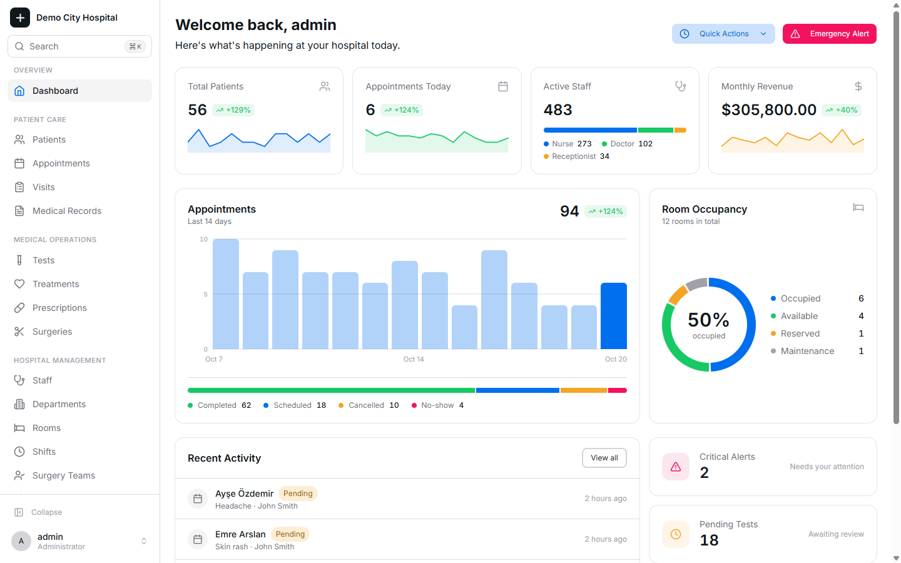

## Highlights

- **A patient file you can work from.** Everything about a patient lives on one page, and you add to it right there: appointments, visits, treatments, prescriptions, lab results, insurance and vital signs.
- **Role-based access control with per-person overrides.** 100+ permissions, 8 built-in roles, your own roles, and "extra" or "blocked" permissions for individuals. Every change is audited.
- **Several hospitals, one system.** Hospitals can belong to a group (network). Each keeps its own patients, staff and records; people only see the hospitals they are assigned to.
- **Reports that read like reports.** Pick a type and a period, get KPIs and charts, then save it, export CSV or print.
- **Designed to look calm.** Flat, consistent UI, light and dark themes, English and Turkish.

## Screenshots

### Sign in

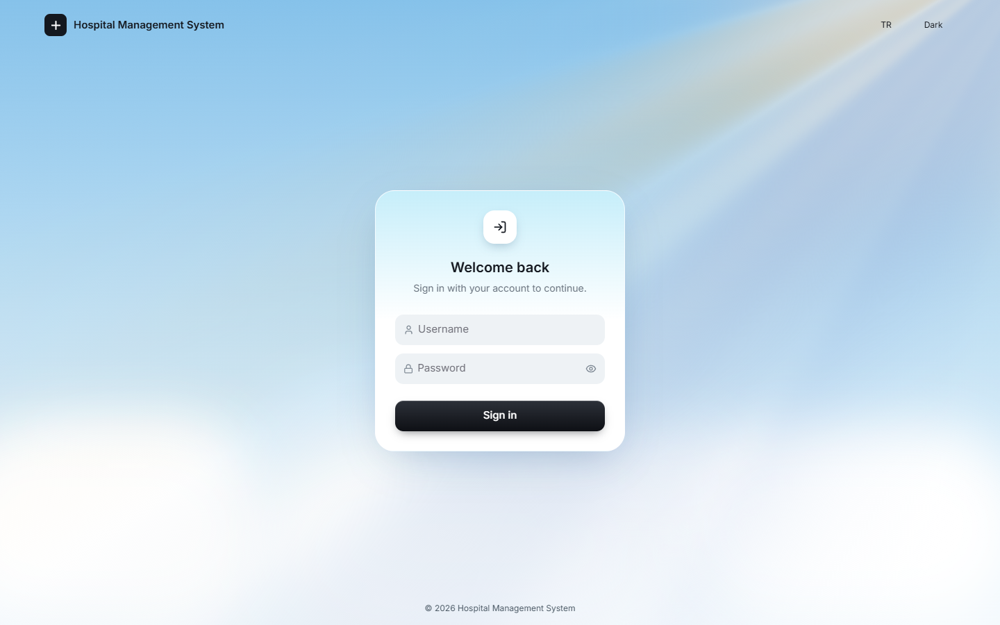

### Patients

Search, filter and register patients. A summary strip shows totals, trend and breakdowns for whatever you are looking at.

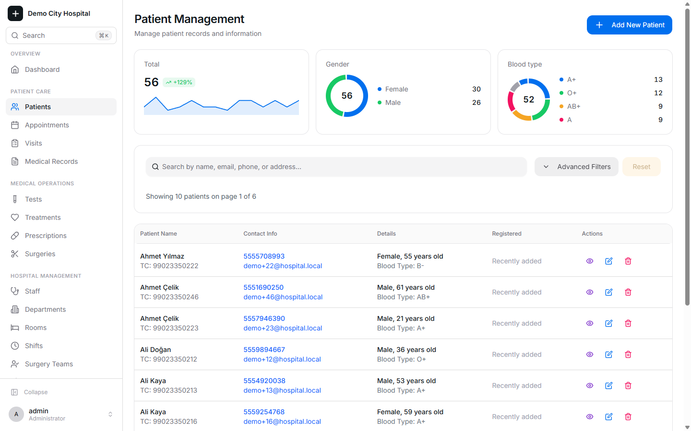

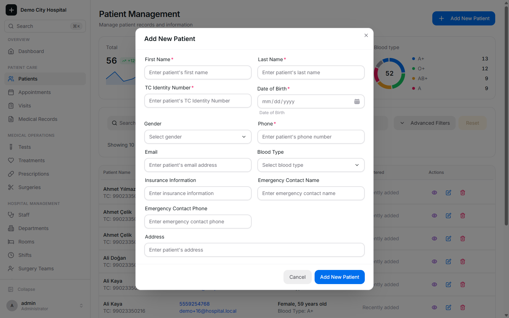

### The patient file

Timeline of everything that happened, key numbers at the top, allergies called out, active medication and insurance on the side.

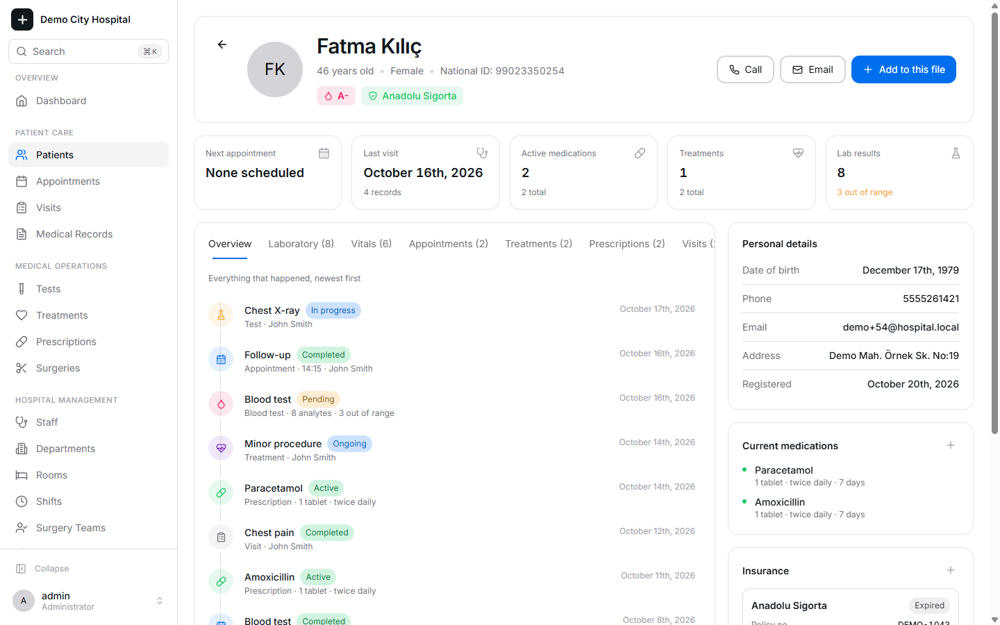

**Add to this file** is available from the header and from every tab. What you can add depends on your permissions.

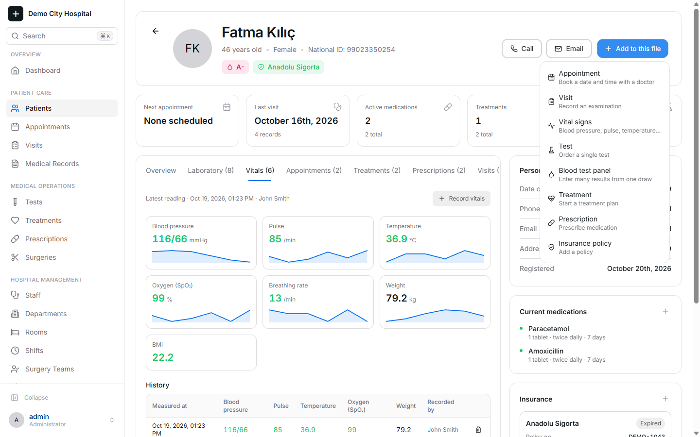

Lab results with reference ranges, out-of-range flags and trends over time:

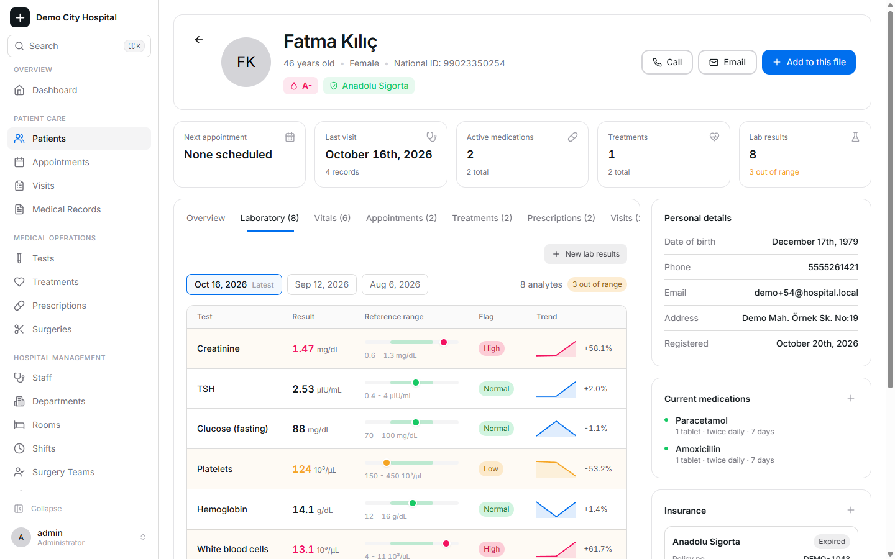

Entering a whole blood panel at once. Reference ranges follow the patient's sex, and each value is flagged as you type:

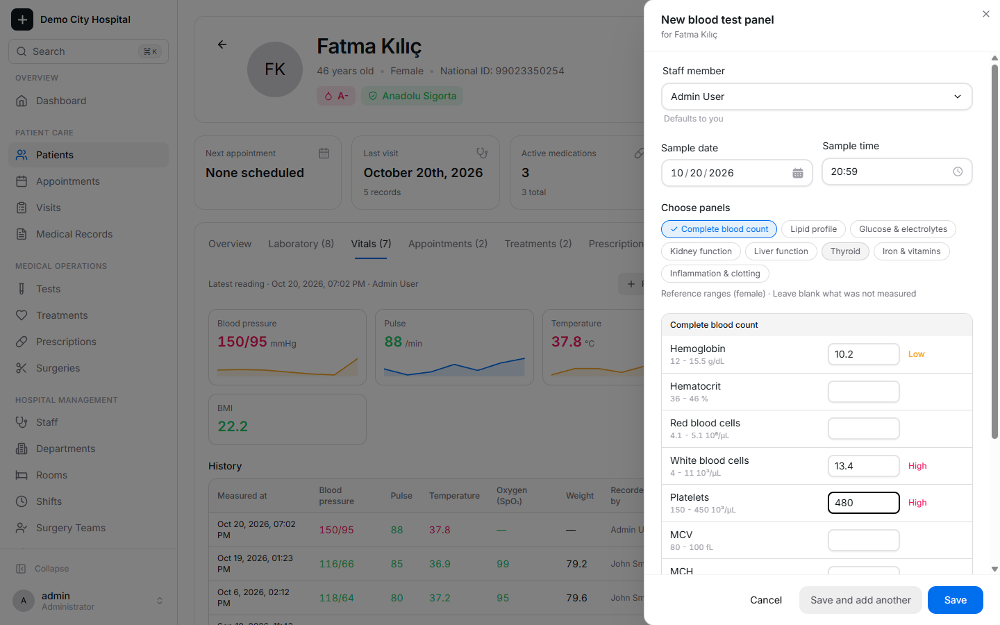

Vital signs with latest readings, sparklines and history:

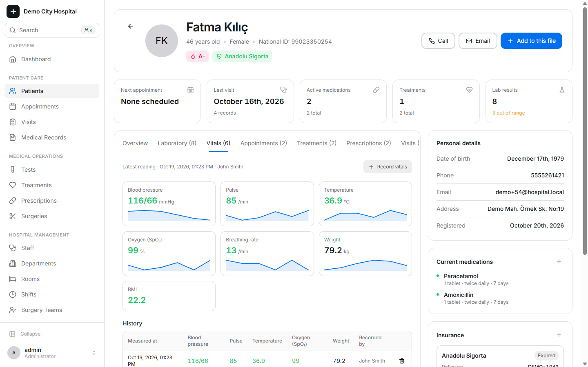

Other forms worth noting: appointments grey out the times a doctor is already booked, and prescriptions show stock and warn about the patient's allergies.

### Staff and permissions

Staff directory with server-side search, filters and bulk actions. Open a person to edit their details, role and sign-in account.

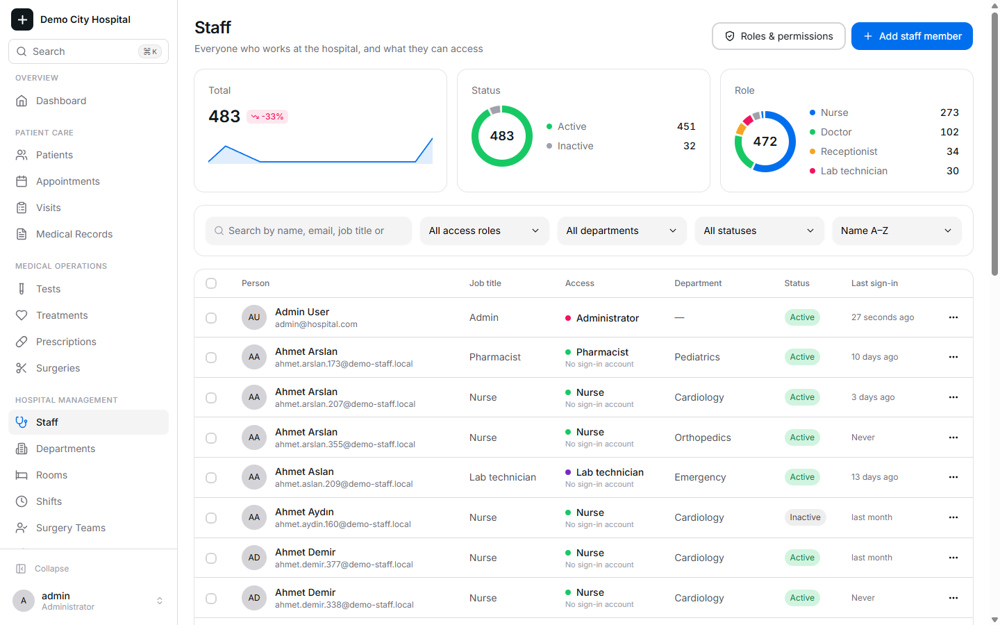

Each person has an access matrix. See what comes from the role, add extra permissions, or block specific ones.

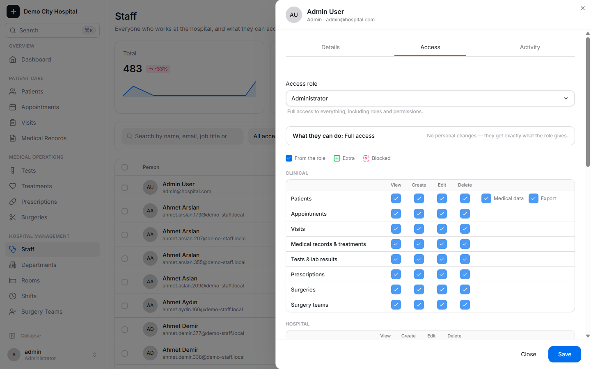

Roles are editable and show who holds them and what changed recently:

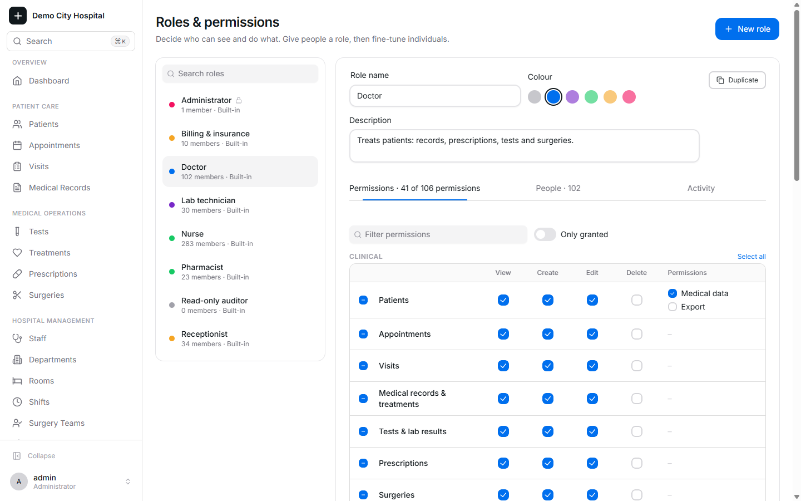

### Reports

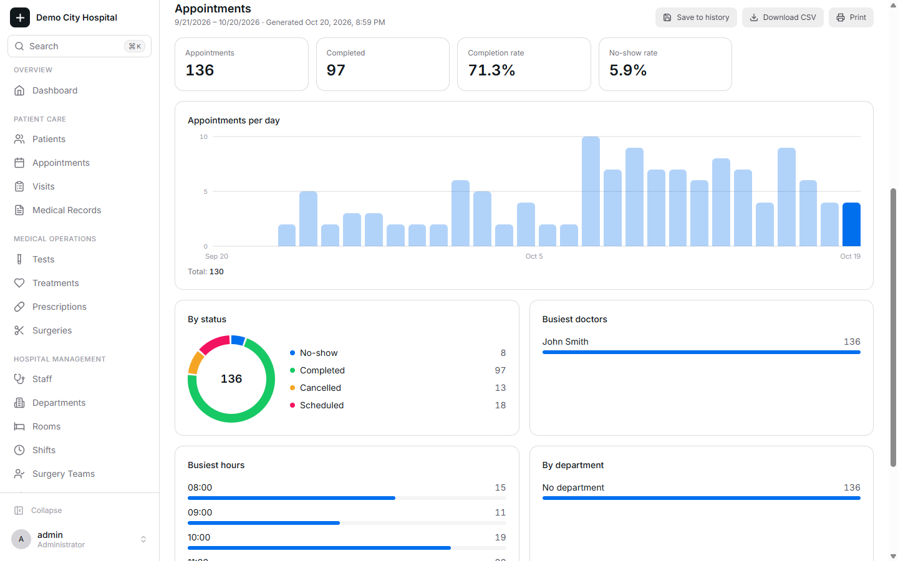

### Hospitals

Hospitals grouped by network, each with its own numbers. Switch between them from the sidebar.

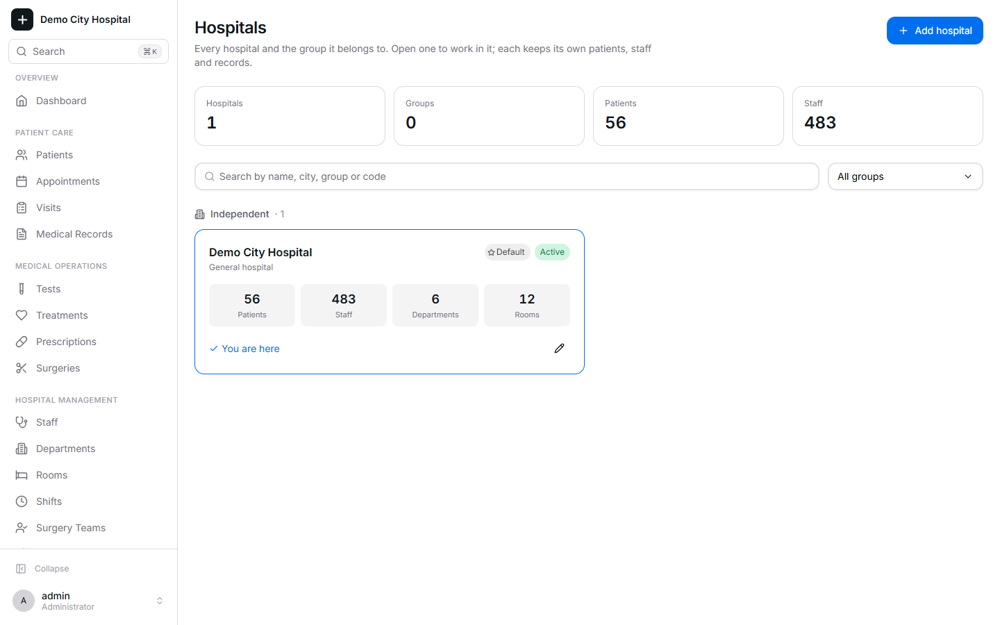

### Dark mode

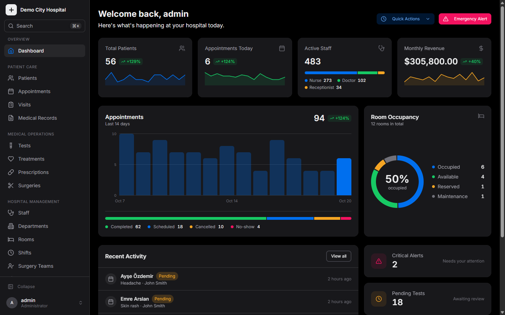

## Features

**Patient care**
- Patients, appointments (double-booking is rejected), visits, medical records
- Tests and lab panels with reference ranges and flags, vital signs with BMI
- Treatments, prescriptions linked to the medication stock, surgeries and surgery teams
- Insurance policies

**Hospital operations**
- Staff, departments, rooms, shifts
- Medications and equipment inventory
- Billing and invoices, blood bank, maintenance requests, incident reports, ambulance fleet
- Complaints, patient feedback, alerts

**Administration**
- Roles and permissions with audit log
- Multiple hospitals and groups
- Reports with history, analytics, activity feed

## Access control

A permission looks like `patients.edit`. Resources have `view`, `create`, `edit` and `delete`, and some have extras such as `patients.medical`, `staff.salary` or `staff.assign_roles`.

| Role | What it is for |
|------|----------------|
| Administrator | Everything |
| Doctor | Treats patients: records, prescriptions, tests, surgeries |
| Nurse | Day-to-day care: vitals, visits, room status |
| Receptionist | Registration, appointments, insurance details, invoices |
| Lab technician | Tests and results, blood bank |
| Pharmacist | Prescriptions and medication stock |
| Billing & insurance | Insurance, billing, financial reports |
| Read-only auditor | Sees everything except sensitive data, changes nothing |

Permissions are read from the database on every request, so changing a role or disabling an account applies immediately. The last administrator can never be removed.

## Tech stack

| Part | Technologies |
|------|--------------|
| Frontend | Next.js 15 (App Router), TypeScript, HeroUI, Tailwind CSS 4, Axios, next-themes |
| Backend | Node.js, Express, Mongoose, JWT, bcrypt, helmet |
| Database | MongoDB (local or Atlas) |
| API docs | Swagger / Scalar at `/api-docs` |

## Getting started

You need Node.js 18+ and a MongoDB database (local or Atlas).

```bash
git clone <repo-url>
cd HospitalProject
```

**Backend**

```bash
cd server
npm install
cp .env.example .env     # then fill in MONGODB_URI and JWT_SECRET
npm run create-users     # creates admin, doctor and nurse accounts
npm run dev              # http://localhost:3000
```

**Frontend**

```bash
cd client
npm install
cp .env.example .env.local
npm run dev              # http://localhost:3001
```

### Demo data

To explore the app with realistic data (patients, appointments, lab results, vitals, staff and more):

```bash
cd server
npm run seed-demo            # add demo data
npm run seed-demo -- --clean # remove it again
```

Everything the seeder creates is tagged, so removing it leaves your own data alone.

### Environment variables

| Server | Description |
|--------|-------------|
| `MONGODB_URI` | MongoDB connection string |
| `JWT_SECRET` | Key used to sign tokens (required) |
| `PORT`, `HOST` | Where the API listens |
| `CORS_ORIGINS` | Comma-separated frontend origins |
| `SEED_*_PASSWORD` | Optional passwords for `npm run create-users` |
| `DNS_SERVERS` | Optional, if `mongodb+srv` lookups fail locally |

| Client | Description |
|--------|-------------|
| `NEXT_PUBLIC_API_URL` | API base URL, for example `http://localhost:3000/api` |

## How multiple hospitals work

Every request carries the hospital you are working in (`X-Hospital-Id`). The server scopes all reads and writes to it, so each hospital has its own patients, staff, rooms and records without every endpoint having to know about it. Administrators can also look at all hospitals together, read-only. Data created before hospitals existed belongs to the default hospital.

## API

All routes live under `/api` and need a bearer token, except `/api/auth/login`. Interactive documentation is available at `/api-docs` while the server runs.

| Area | Routes |
|------|--------|
| Auth | `/auth/login`, `/auth/me`, `/auth/password` |
| Patients | `/patients`, `/patients/:id/overview`, `/patient-records/:patientId/:type` |
| Clinical | `/appointments`, `/visits`, `/tests`, `/treatments`, `/prescriptions`, `/surgeries` |
| Hospital | `/staff`, `/departments`, `/rooms`, `/shifts`, `/hospitals` |
| Inventory | `/medications`, `/equipment`, `/blood-bank` |
| Operations | `/billing`, `/maintenance`, `/incidents`, `/ambulances` |
| Admin | `/access/*` (roles, permissions, audit), `/reports/*`, `/dashboard/*` |

## Project structure

```
HospitalProject/
├── client/                 Next.js app
│   ├── app/                Pages (dashboard, login)
│   ├── components/         Shared UI (patient drawer, charts, switcher)
│   ├── contexts/           Auth, language, hospital
│   ├── lib/                API client, helpers, lab panels, report text
│   └── locales/            English and Turkish strings
├── server/                 Express API
│   ├── src/Controllers/    Request handlers and the report engine
│   ├── src/Routes/         API routes
│   ├── src/Modules/        Database models, permissions, hospital scoping
│   └── scripts/            Seed and maintenance scripts
└── docs/screenshots/       Images used in this README
```

## Contributing

1. Fork the repository
2. Create a branch: `git checkout -b feature/your-feature`
3. Commit your changes and push the branch
4. Open a pull request

## License

MIT

## Built with

[Next.js](https://nextjs.org/), [HeroUI](https://heroui.com/), [Express](https://expressjs.com/), [MongoDB](https://www.mongodb.com/), [Mongoose](https://mongoosejs.com/), [Tailwind CSS](https://tailwindcss.com/)
